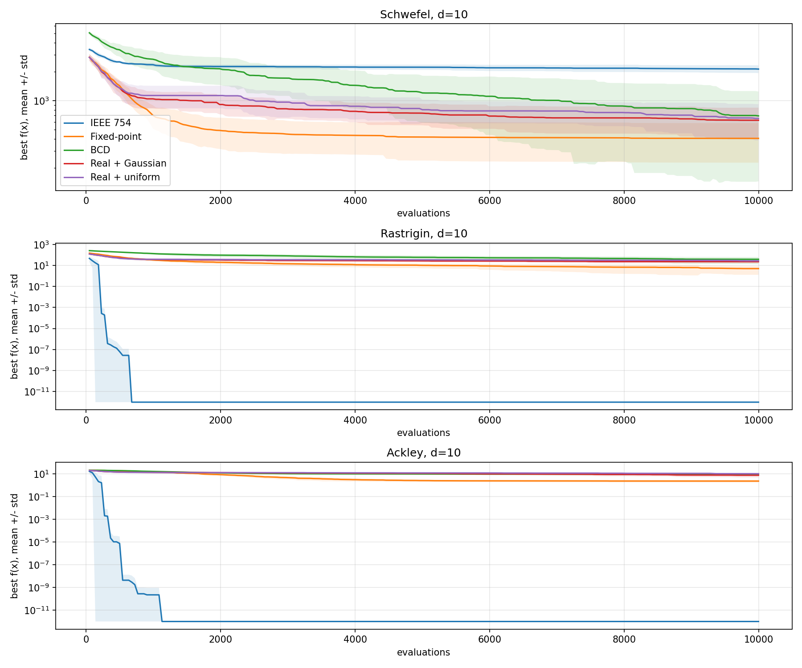

# AP9EV excercise 2

Project for the Evolutionary Computation Techniques class. Second assignment.

Author: [Ondřej Hruboš](https://github.com/hruboson), [Github repository](https://github.com/hruboson/AP9EVex2)

This implementation builds on the algorithm and object-oriented implementation of the first assignment, while adding new classes representing the continuous implementation.

# Experiments

The algorithm is run 10 000 times for each test functions and problem in 10 dimensions.

At the end I try to find the best hyperparameter settings by running the algorithm using different variants of hyperparameters. Best results for each test function and problem are shown. You can find example output in the [`out.txt`](./out.txt) file.

# Results

Convergence graph:

Output shown as table:

Schwefel, d=10
  IEEE 754           mean    2124.6609  std   198.0172  best    1807.6239
  Fixed-point        mean     404.2138  std   178.2633  best      81.8457
  BCD                mean     692.9258  std   548.5380  best       2.0123
  Real + Gaussian    mean     623.7102  std   219.3024  best     134.3633
  Real + uniform     mean     651.5189  std   266.6609  best     237.7958

Rastrigin, d=10
  IEEE 754           mean       0.0000  std     0.0000  best       0.0000
  Fixed-point        mean       4.9694  std     3.7018  best       0.0634
  BCD                mean      38.1964  std    25.1454  best      13.2318
  Real + Gaussian    mean      22.5406  std     6.9665  best      12.6198
  Real + uniform     mean      27.3068  std     6.6001  best      16.3573

Ackley, d=10
  IEEE 754           mean       0.0000  std     0.0000  best       0.0000
  Fixed-point        mean       2.3461  std     0.6016  best       1.1716
  BCD                mean       9.2296  std     1.9285  best       5.7320
  Real + Gaussian    mean       7.7079  std     2.7714  best       4.7031
  Real + uniform     mean      10.4612  std     1.1815  best       8.6814

Optimal hyperparameters for each test function and solved problem:

Best parameters: Schwefel, d=10
	IEEE 754              1855.1286  p=0.02  sigma_ratio=0.05  selection=roulette
	Fixed-point            223.9531  p=0.02  sigma_ratio=0.05  selection=rank
	BCD                    341.4462  p=0.0075  sigma_ratio=0.05  selection=rank
	Real + Gaussian        594.4231  p=0.05  sigma_ratio=0.01  selection=rank
	Real + uniform         610.6386  p=0.05  sigma_ratio=0.05  selection=rank

Best parameters: Rastrigin, d=10
	IEEE 754                 0.0000  p=0.001  sigma_ratio=0.05  selection=roulette
	Fixed-point              4.4126  p=0.02  sigma_ratio=0.05  selection=rank
	BCD                     33.9558  p=0.02  sigma_ratio=0.05  selection=rank
	Real + Gaussian         18.9872  p=0.05  sigma_ratio=0.01  selection=roulette
	Real + uniform          27.3068  p=0.05  sigma_ratio=0.05  selection=roulette

Best parameters: Ackley, d=10
	IEEE 754                 0.0000  p=0.001  sigma_ratio=0.05  selection=roulette
	Fixed-point              2.1700  p=0.0075  sigma_ratio=0.05  selection=rank
	BCD                      7.6800  p=0.02  sigma_ratio=0.05  selection=rank
	Real + Gaussian          7.0994  p=0.05  sigma_ratio=0.05  selection=rank
	Real + uniform          10.4612  p=0.05  sigma_ratio=0.05  selection=roulette

## Run

- Either use the prepared [`nix`](./shell.nix) shell file:
    - Install [`nix`](https://nixos.org/download/) on your system (currently only for Linux/MacOS)
    - Enter the shell: `nix-shell ./shell.nix`
    - Run the Python script: `python ./main.py`
- Use your own installation of **Python 3.14** (older versions will most likely not work due to the usage of type hints!)
    - Create a virtual environment with the attached [`requirements.txt`](./requirements.txt): 
        - Windows: `python -m venv .venv && .venv\\Scripts\\activate && pip install -r requirements.txt`
        - Linux/MacOS: `python -m venv .venv && . .venv/bin/activate && pip install -r requirements.txt`
    - Run the Python script: `python ./main.py`
    - Leave virtual environment: `deactivate`
